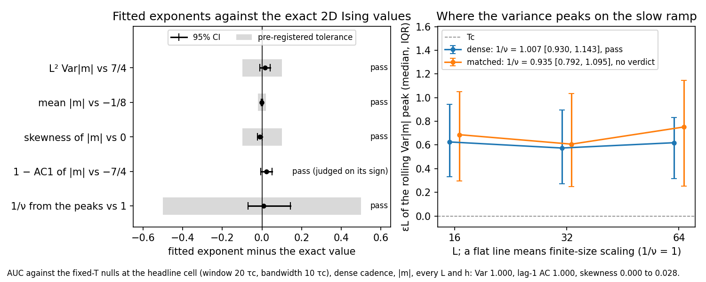
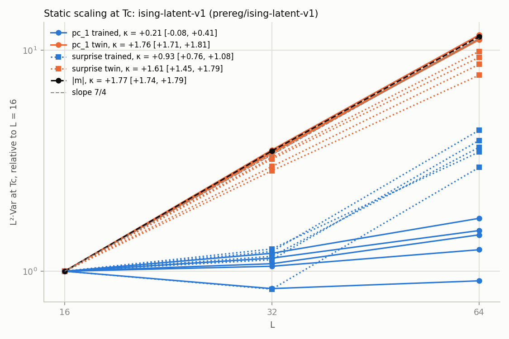

# Tipping Point

Can a self-supervised world model warn of a market's volatility-regime shifts earlier and more
reliably than the classic early-warning indicators? Tipping Point trains a JEPA (joint-embedding
predictive architecture) on the order books of the BTC and ETH perpetual futures and tests warnings
read from its latents against rolling variance, autocorrelation and skewness.

A market has no ground truth for what a model should learn, so the method is first checked on the
2D Ising model, whose critical temperature and exponents are known exactly. A signal that claims to
track the Ising transition must change with lattice size as finite-size scaling predicts. The
market experiment is the claim; the Ising experiments are the supporting evidence.

## Results

| experiment | what it tests | outcome | full numbers |
|---|---|---|---|
| ising-ews-v1 | Classic indicators of the magnetisation \|m\| on a slow cooling ramp: do they warn of the transition and obey finite-size scaling? | All five hypotheses pass. | [results](docs/results.md#ising-ews-v1-the-classic-baseline) |
| ising-latent-v1 | The same indicators read from a JEPA's latents, and whether the trained model beats its untrained twin. | Four of five judged rows pass. The one that fails: the variance of the trained models' leading latent component mostly does not rise before the transition. | [results](docs/results.md#ising-latent-v1-the-latent-experiment) |
| market-ews-v1 | Classic indicators of 1-minute returns before volatility-regime shifts in BTC and ETH perpetuals. | Pre-registered; frozen before scoring; not yet scored. | [market-ews-v1.toml](paper/prereg/market-ews-v1.toml), tag `prereg/market-ews-v1` |
| market-latent-v1 | Warnings read from the market JEPA's latents, against the classic indicators and the untrained twins. | Pre-registered; frozen before scoring; not yet scored. | [market-latent-v1.toml](paper/prereg/market-latent-v1.toml), tag `prereg/market-latent-v1` |



ising-ews-v1. Left: each judged exponent minus its exact value, with its 95% CI and tolerance.
Right: where the rolling variance of |m| peaks at each L; a flat line in L means finite-size scaling.



ising-latent-v1. Static scaling at Tc, relative to L = 16: the untrained twins' first principal
component follows |m| and the exact slope 7/4; the trained models' does not.

## Method

**Data.** The Ising data come from a GPU simulator of the 2D Ising model (checkerboard Metropolis)
at lattice sizes L = 16, 32 and 64: slow cooling ramps through the critical temperature Tc,
fixed-temperature null runs above it, and quasi-static staircases. The market data are Bybit's
public order-book archive for the BTCUSDT and ETHUSDT linear perpetuals, reduced to 1-second book
features, and Binance's public 1-minute klines, 5-minute metrics and funding rates, which the labels
read. See [docs/ising.md](docs/ising.md), [docs/market.md](docs/market.md) and
[docs/engine.md](docs/engine.md).

**Model.** A JEPA has an encoder that maps an input to a latent vector and a predictor that
predicts the latent of a hidden part of the input, as a slowly updated copy of the encoder (the
target encoder) computes it. The loss lives in latent space, with variance and covariance terms
against collapse. On Ising the input is a lattice frame; on the market it is one minute of book
features, and a causal predictor reads past minutes' latents to predict the coming minutes'. Every trained model keeps its untrained
twin (the same network at step 0), which goes through every test: a random local encoder already
inherits some of the physics, so learning is claimed only as a margin over the twin.

**Labels.** On Ising the event is the transition itself, at the known Tc, and temperature is
measured as the scaled distance eps_L = L (T - Tc) / Tc. On the market a two-state hidden Markov
model of deseasonalised 5-minute realised variance, refitted weekly and read only from past data,
marks high- and low-volatility regimes. An event is a high-volatility episode that follows a calm
window; controls are calm windows with no event nearby. The labelling rule was frozen before any
day of the test span was labelled.

**Warning indicators.** The classic indicators are the rolling variance, lag-1 autocorrelation and
skewness of a series, and the trend of each over a window. On Ising the series is |m|; on the
market it is the 1-minute returns. The latent indicators apply the same statistics to the JEPA's
surprise (its prediction error) and to the leading principal components of its latent.

**Scoring.** A warning is scored by the AUC of an indicator's trend before events against the same
trend on null or control segments, with bootstrap confidence intervals and surrogate tests. On
Ising the indicators must also obey finite-size scaling: static exponents at Tc against the exact
ones, and a peak position that scales as 1/nu = 1. The market tests add a floor from a
volatility-clustering (GARCH) process with no critical dynamics. The scorer logs every evaluated
cell and counts it against the trial budget the pre-registration fixes. See
[docs/preregistration.md](docs/preregistration.md).

## Pre-registration

Each test is written down in a file in [`paper/prereg/`](paper/prereg/): its hypotheses, the
numbers that would confirm or refute them, its data, its parameters and its trial budget. The file
is frozen at a git tag before its confirmatory data are read, and the scorer refuses a file that
differs from the tagged one, runs not made from the tag's commit, or a scoring past the budget.
Each file states what was seen before its freeze (`[disclosure]`) and logs any change after it
(`[deviations]`); a change after the freeze is a new version. Choices made after an exploratory
look are disclosed as such: ising-latent-v1's rules were rewritten after exploratory reads of two
models, and market-labels-v1's null-stretch rule was chosen after the pilot, outside the ranges
declared beforehand.

| file | tag | what it fixes |
|---|---|---|
| [ising-ews-v1.toml](paper/prereg/ising-ews-v1.toml) | `prereg/ising-ews-v1` | the classic Ising baseline: five hypotheses on \|m\| |
| [ising-latent-v1.toml](paper/prereg/ising-latent-v1.toml) | `prereg/ising-latent-v1` | the Ising latent experiment: the pinned checkpoints and their twins |
| [market-labels-v1.toml](paper/prereg/market-labels-v1.toml) | `prereg/market-labels-v1` | the market regime, event, control and cascade labels |
| [market-ews-v1.toml](paper/prereg/market-ews-v1.toml) | `prereg/market-ews-v1` | the classic market test: two hypotheses on 1-minute returns |
| [market-latent-v1.toml](paper/prereg/market-latent-v1.toml) | `prereg/market-latent-v1` | the market latent test: the pinned checkpoints, their twins and four latent pairs |

Both market tests are frozen and neither is scored yet. The scorer refuses to score either on a
day of the confirmatory span unless both are frozen. The templates the files start from sit beside
them.

Some frozen files point to a README section by name, such as "README: Which stream a run draws".
Those sections now live in [`docs/`](docs/): that one is in
[docs/ising.md](docs/ising.md#which-stream-a-run-draws).

## Reproduce

With [uv](https://docs.astral.sh/uv/) installed, from the repository root:

```sh
uv sync --extra cpu                             # the Python environment (--extra cu126 on a CUDA machine)
uv run python harness/gate.py                   # every Rust and Python check; needs cargo on PATH
uv run python -m tipping_point.ising validate   # a small simulator run, checked against exact results
```

The scorer accepts only runs made from the freeze tag's commit, from a clean tree, so check out
that commit to regenerate data. GPU jobs run as Kaggle kernels from plans in `notebooks/plans/`
(`uv run python notebooks/kaggle_ising_runs.py --write-kernel <plan> <dir>`, then
`kaggle kernels push -p <dir>`); the runner's `--help` is its manual.

**ising-ews-v1.** The 75 confirmatory runs come from `notebooks/plans/v1-confirmatory.json`: 2.62 h
of wall time on Kaggle's two T4 GPUs. Then:

```sh
uv run python -m tipping_point.ews score --prereg paper/prereg/ising-ews-v1.toml
uv run --with matplotlib==3.10.3 python harness/ews_v1_figure.py <result folder> paper/figures/ising-ews-v1.png
```

**ising-latent-v1.** The trainings come from `notebooks/plans/primary-28.json` (5.67 GPU-hours on
Kaggle T4s) and `notebooks/plans/ablations-28.json` (6.62 GPU-hours), and the latents from
`extract-s6.json` to `extract-s10.json` (129.3 GPU-hours). The scoring took about 39 hours on a
4-core laptop CPU (i7-1185G7):

```sh
uv run python harness/latent_data_dir.py --prereg paper/prereg/ising-latent-v1.toml --into <new data dir> --from <kaggle out> ...
uv run python harness/ising_experiment.py --prereg paper/prereg/ising-latent-v1.toml --data-dir <new data dir>
```

**Market.** The labels and book features need the raw exchange data, which each reader downloads;
the commands below fetch it from the exchanges' public archives. The market tests are not yet
scored.

```sh
uv run python -m tipping_point.market fetch --start 2022-07-01 --end 2026-09-30
uv run --locked --exact python -m tipping_point.market labels --prereg paper/prereg/market-labels-v1.toml   # span and parameters from the file
uv run python -m tipping_point.market book --range training
```

## Feature map

In pipeline order. Paths are relative to `python/tipping_point/src/tipping_point/` unless they start
with `engine/`, `harness/` or `notebooks/`.

| step | feature | command | code |
|---|---|---|---|
| get the data | Fetch Binance archives | `uv run python -m tipping_point.market fetch --start <day> --end <day>` | `market/archive.py` |
| get the data | Import an archive day | `cargo run --release -p engine --bin store -- import <archive>` | `engine/src/store/` |
| get the data | Ising pilot and tau_c fit | `uv run python -m tipping_point.ising pilot --L 16` then `ising tauc <run dir> ...` | `ising/` |
| get the data | Ising runs: staircase, ramp, null | `uv run python -m tipping_point.ising ramp --L 16 --x 0.02 --pilot <pilot.json>` | `ising/` |
| get the data | Run a plan on Kaggle GPUs | `uv run python notebooks/kaggle_ising_runs.py --write-kernel <plan> <dir>` | `notebooks/` |
| build book features | Book feature range | `uv run python -m tipping_point.market book --range training` | `market/book.py` |
| build book features | Reduce one book day | `uv run python -m tipping_point.book <samples.parquet>` | `book/` |
| build book features | Assemble book ranges | `uv run python harness/book_assemble.py --out <dir> --commit <sha> <source dir>` | `harness/book_assemble.py` |
| train a model | Train an Ising JEPA | `uv run python -m tipping_point.jepa train --L 16 32 --train-seeds 101 102 --val-seed 103 --seed 1 --pilot <pilot.json>` | `jepa/` |
| train a model | Market JEPA pilot | `uv run python harness/m4_pilot.py train --asset btc --size S --data <dir> --out <dir>` | `harness/m4_pilot.py`, `jepa/minutes.py` |
| train a model | Market JEPA primaries | `uv run python harness/m8_primaries.py train --asset btc --seed 101 --data <dir> --out <dir>` | `harness/m8_primaries.py` |
| extract latents | Extract latents | `uv run python -m tipping_point.jepa extract <checkpoint> <run dir>` | `jepa/extract.py` |
| extract latents | Extract market latents | `uv run python -m tipping_point.jepa.market_extract run --pins <pins.json> --primaries <dir> --data <dir> --span exploratory --out <dir>` | `jepa/market_extract.py` |
| extract latents | Probe a training | `uv run python -m tipping_point.jepa probe <training dir> --fit <run dir>` | `jepa/probes.py` |
| label events | Regime labels | `uv run python -m tipping_point.market labels --start <day> --end <day>` | `market/` |
| label events | Cascade candidates | `uv run python -m tipping_point.market cascade --start <day> --end <day>` | `market/cascade.py` |
| label events | Labels reports and GARCH floor | `uv run python -m tipping_point.market reports --run <labels run>` | `market/reports.py`, `harness/market_floor.py` |
| score a test | Freeze a pre-registration | `uv run python -m tipping_point.ews prereg freeze <id>` | `ews/prereg.py` |
| score a test | Score a classic pre-registration | `uv run python -m tipping_point.ews score --prereg <file>` | `ews/` |
| score a test | Score a latent experiment | `uv run python harness/ising_experiment.py --prereg <file>` | `harness/ising_experiment.py` |
| make figures | ising-ews-v1 figure | `uv run --with matplotlib==3.10.3 python harness/ews_v1_figure.py <result dir> <png>` | `harness/ews_v1_figure.py` |
| make figures | Latent experiment figures | `uv run python harness/ising_experiment.py --figures-only <result dir>` | `harness/ising_figures.py` |

[`features.json`](features.json) lists every command with its inputs, outputs and test.

## Data and licences

The raw Binance and Bybit data are not redistributed. The repository publishes the code, the frozen
pre-registrations, the result figures and numbers, and small test fixtures, one of which holds
book samples imported from a tiny synthetic archive in Bybit's format (`engine/tests/fixtures/archives/`). Simulator runs, trained models and
latents are not committed; the commands above regenerate them.

`tipping_point.market fetch` downloads Binance's USD-M archives from Binance Vision and checks each
file against its published checksum; `tipping_point.market book` downloads Bybit's order-book
archive a day at a time and keeps only the features. Binance's archives are licensed CC BY-NC-SA
4.0: anything derived from them and published carries that licence and the attribution "Binance
Vision". Bybit's archive is used under Bybit's terms.

## Status

As of 20 November 2026:

- Done: both Ising experiments, scored; the market labels and both market warning tests, frozen;
  the market JEPAs, trained, and their latents extracted.
- Next: score both market tests on January 2024 to September 2026.

The target is a workshop paper in early 2027. Design discussions are on the
[issue tracker](https://github.com/GabrielEzerzer/tipping-point/issues).

## Citation and licence

To cite this work, use [CITATION.cff](CITATION.cff). Tipping Point is released under the MIT licence;
see [LICENSE](LICENSE).
