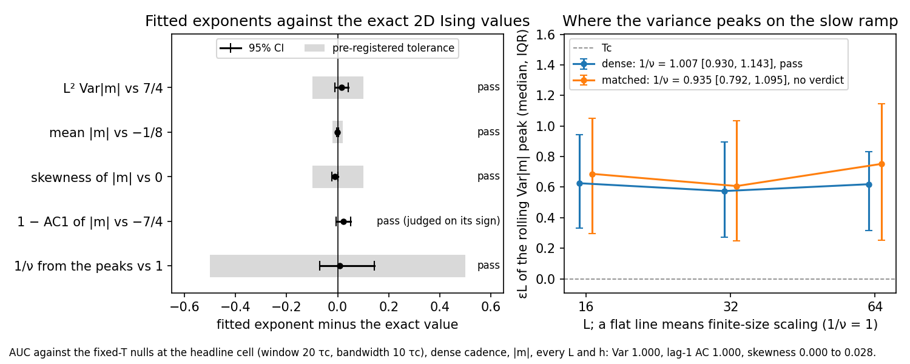
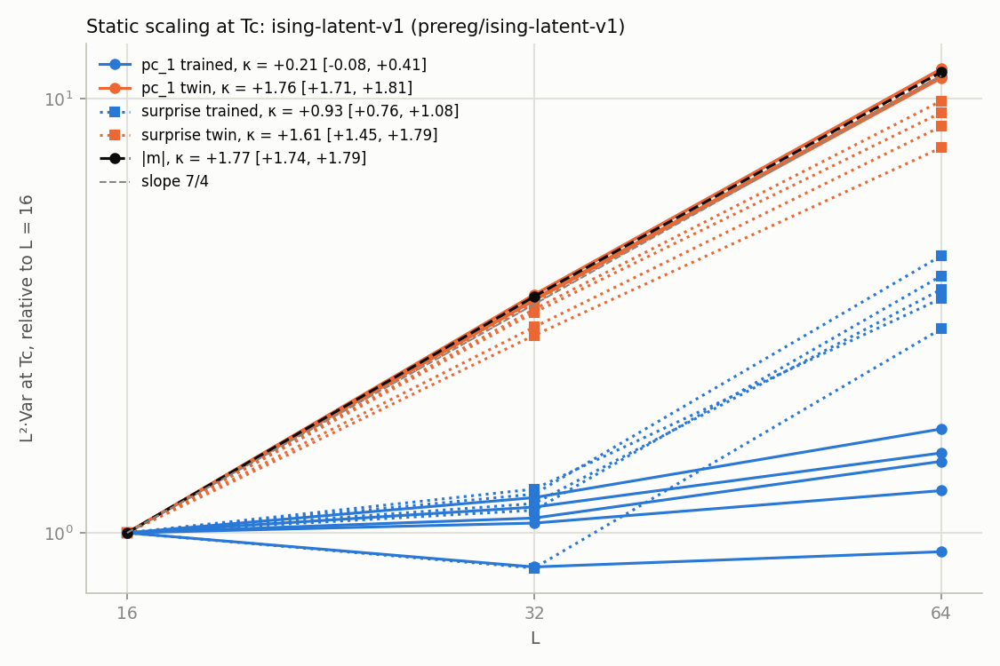
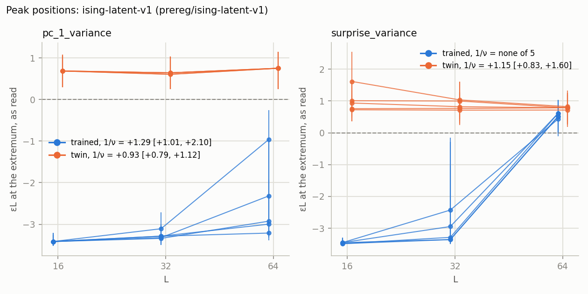

# Results

The two scored experiments, both on the 2D Ising model. The market tests are frozen and not yet
scored; see [preregistration.md](preregistration.md).

## ising-ews-v1: the classic baseline

The pre-registration `paper/prereg/ising-ews-v1.toml`, frozen as the tag `prereg/ising-ews-v1`
(commit aa29cbc), was scored on 4 November 2026 at commit 22da489 from a clean tree, with seed 26
for the bootstrap and surrogate draws. It read the 75 confirmatory runs generated on Kaggle from the
tagged commit (seeds 6-10 at L = 16, 32 and 64: slow ramps, fixed-T null runs and staircases), and
no null block or staircase plateau was dropped. The result is run `20261104T095100Z-ising-ews-v1`,
and that one scoring spent the whole budget of 972 trials.

Left, each judged exponent minus its exact value, with its 95% CI and its pre-registered tolerance in grey (1 - AC1 is judged on its sign alone, so it has no band); right, the median eps_L at which each replica's rolling Var(|m|) peaks, with interquartile ranges, where a flat line in L means finite-size scaling.

All five hypotheses pass.

1. **static-positive-control: pass.** At the staircase plateau nearest Tc, the fitted exponent of
   L^2 Var(|m|) is 1.766 [1.739, 1.792] against 7/4 (tolerance 0.1), that of the mean |m| is
   -0.1253 [-0.1289, -0.1219] against -1/8 (tolerance 0.02), and that of the skewness of |m| is
   -0.011 [-0.022, 0.002] against 0 (tolerance 0.1). The exponent of tau_int(|m|), reported without
   a verdict, is 2.199 [2.147, 2.252]; the dynamic exponent z of local Metropolis is about 2.17.
2. **classic-rise: pass.** At the headline cell (window 20 tau_c, bandwidth 10 tau_c), on the dense
   cadence, the AUC of Var(|m|) and of the lag-1 autocorrelation of |m| against the fixed-T nulls is
   1.000, with CI [1.000, 1.000], at every L and at every horizon h = 0, 1 and 2.
3. **skewness-falls: pass.** In the same cell, the AUC of the skewness of |m| lies between 0.000 and
   0.028, and every CI lies below 0.5.
4. **dynamic-fss: pass.** 1/nu, fitted on the eps_L at which each replica's rolling Var(|m|) peaks
   on the dense cadence, is 1.007 [0.930, 1.143], with every bootstrap draw used. The median peak
   eps_L is 0.63, 0.57 and 0.62 at L = 16, 32 and 64, and every replica's peak was located inside
   the search band (edge fraction 0). The matched cadence's robustness row, reported without a
   verdict, gives 0.935 [0.792, 1.095].
5. **ac1-reference: pass.** The exponent of 1 - AC1(|m|) at a one-sweep lag is -1.728
   [-1.757, -1.700], negative with a CI that excludes 0. It tracks -gamma/nu = -7/4, not -z.

Reported without a verdict: with the alarm threshold set for one false alarm per 1000 tau_c, the
held-out half of the null runs gives 0.72 to 1.29 false alarms per 1000 tau_c. On the dense
cadence, Var and AC1 of |m| are already above their thresholds in every replica when the alarm band
opens at eps_L = 2. The skewness is too in 76 to 80% of the replicas, and the rest alarm inside the
band at a median eps_L of about 1.7. At the headline cell, the matched cadence weakens AC1 of |m| at
L = 64 (AUC 0.80 to 0.83). With the energy as the observable, on the dense cadence, Var reaches an
AUC of 0.999 to 1.000 and AC1 0.83 to 1.00, while the skewness is weak (0.18 to 0.46). The surrogate
tests give 3.8 to 6.9% false positives at alpha = 0.05. At this ramp rate (x = 0.02) the classic
indicators are a saturated positive control: the judged discrimination questions (hypotheses 2
and 3) land at or near AUC 1 and 0, so the exponents are the informative numbers.

To reproduce: with the 75 runs in the data dir, `uv run python -m tipping_point.ews score --prereg paper/prereg/ising-ews-v1.toml` scores them, and `uv run --with matplotlib==3.10.3 python harness/ews_v1_figure.py <result folder> paper/figures/ising-ews-v1.png` redraws the figure from the result.

The exploratory tables from the seeds 1-5 datasets at L = 16 and 32 are superseded by this result.

## ising-latent-v1: the latent experiment

The pre-registration `paper/prereg/ising-latent-v1.toml`, frozen as the tag
`prereg/ising-latent-v1` (commit b19c2df), was scored at commit 25147a0 from a clean tree, from 16
to 18 November 2026. It read the latents of five primary JEPA checkpoints (m1-m5), six ablation
checkpoints and the untrained step-0 twin of each, extracted from the same 75 confirmatory runs.
The result is run `20261116T163243Z-ising-latent-v1`, and it spent the whole budget of 3,132 trials.
Cells are the headline cell on the matched cadence at L = 16, 32 and 64 and h = 0, 1 and 2, nine per
checkpoint; intervals are 95% bootstrap percentiles.

The static scaling at Tc, each line relative to its value at L = 16: the twins' first principal
component (pc_1) follows |m| and the slope 7/4, and the trained checkpoints' does not.

Four of the five judged rows pass.

1. **latent-pipeline-check: pass.** Every twin's exponent of L^2 Var(pc_1) lies within 0.15 of
   7/4: 1.741 to 1.777, 11 of 11. The trained primaries' lie between -0.07 and +0.40, reported
   without a verdict.
2. **latent-variance-rises, trained: fail.** The rule asks every primary's AUC CI to lie above 0.5
   at every L and h, for Var(pc_1) and AC1(pc_1). Var(pc_1) does so in 17 of 45 cells and lies
   below 0.5 in 27. AC1(pc_1) does so in 42 of 45; m2 misses at L = 32, h = 1, and at L = 64,
   h = 1 and 2. On the twins, read separately, both pass in all 45 cells (Var 0.998 to 1.000,
   AC1 0.802 to 0.998).
3. **latent-dynamic-fss: pass.** Every twin's 1/nu, fitted on where Var(pc_1) peaks, is 0.934 to
   0.936, with CIs of about [0.79, 1.12], 11 of 11.
4. **learned-beyond-random (a): pass.** The energy probe's R^2, trained minus twin, is +0.00249
   [+0.00222, +0.00274] as the mean over L, and all 15 paired margins are positive.
5. **learned-beyond-random (b): pass.** The same margin for the energy probe's selectivity is
   +0.00043 [+0.00027, +0.00060], 15 of 15 positive.

Both margins in (a) and (b) are small. The untrained twin already reads the energy almost
perfectly: its R^2 is 0.99507, 0.99787 and 0.99908 at L = 16, 32 and 64, against 0.99965, 0.99989
and 0.99996 trained, so the margin shrinks with L (+0.0046, +0.0020, +0.0009). The selectivity
margin lies below the file's tolerance of 0.002, but its CI excludes 0, which the file counts as a
pass.

The scaled temperature eps_L at which each rolling variance peaks, per L: left Var(pc_1), right
Var(surprise). The twins' peaks sit at about the same eps_L at every L, as finite-size scaling
predicts. The trained checkpoints' positions near eps_L = -3.4 lie on or next to the search band's
cold edge, where most replicas have no located peak (for Var(pc_1), 78-83% of them at L = 16 and
55-73% at L = 32). At L = 64 the trained Var(pc_1) spreads out, and the trained Var(surprise) moves
to about eps_L = +0.4 to +0.6.

Reported without a verdict:

- Beside the twin, the trained Var(pc_1) loses AUC: -0.592 [-0.730, -0.453] as the mean over L and
  h, and from -0.39 to -0.85 by seed. AC1(pc_1) loses -0.051 [-0.149, +0.010]. Under ising-ews-v1,
  |m| averages 0.9993 for its variance and 0.9264 for AC1.
- Var(surprise) has its AUC CI above 0.5 in all 45 trained and all 45 twin cells. The trained
  surprise's static exponent is 0.78 to 1.06 (twins 1.47 to 1.76), and its peaks give no 1/nu on
  any primary.
- The trained Var(pc_1)'s 1/nu, 1.04 to 1.91 across the primaries, is inconclusive under the
  file's edge rule: at L = 16, 78-83% of each primary's replicas take their extremum on the band's
  cold edge or within one window of it, so the fits rest on the few peaks that were located.
- Other probes, trained minus twin, as the mean over L: L^2 Var R^2 +0.103 [+0.093, +0.112], its
  selectivity +0.065 [+0.057, +0.073]; |m| R^2 -0.00019, with the twins at 0.99997 and above.
- Ablations, three seeds each. EMA-only: energy R^2 margin +0.00248, selectivity +0.00003
  [-0.00019, +0.00025], and on Var(pc_1) it reads like its twin (AUC margin +0.0005). Held-out band (trained
  without the plateaus at T in [2.0, 2.5]): energy R^2 margin +0.00245, selectivity +0.00034, Var(pc_1) AUC margin -0.354.

In short: through a random encoder, the pipeline reproduces the exact Ising scaling, so the method
can find it. The trained encoders do not keep it in their leading direction: the variance of their
pc_1 mostly does not rise before Tc, and what they gain over the random encoder on the energy
probe is small. The variance of their surprise rises before Tc on every trained checkpoint, as it
does through the random encoder. How the
run took its 39 hours is under [The latent experiment](preregistration.md#the-latent-experiment).

To reproduce: with the runs and their latents in the data dir, `uv run python harness/ising_experiment.py --prereg paper/prereg/ising-latent-v1.toml` scores them, and `--figures-only <result folder>` redraws the figures from the result.
